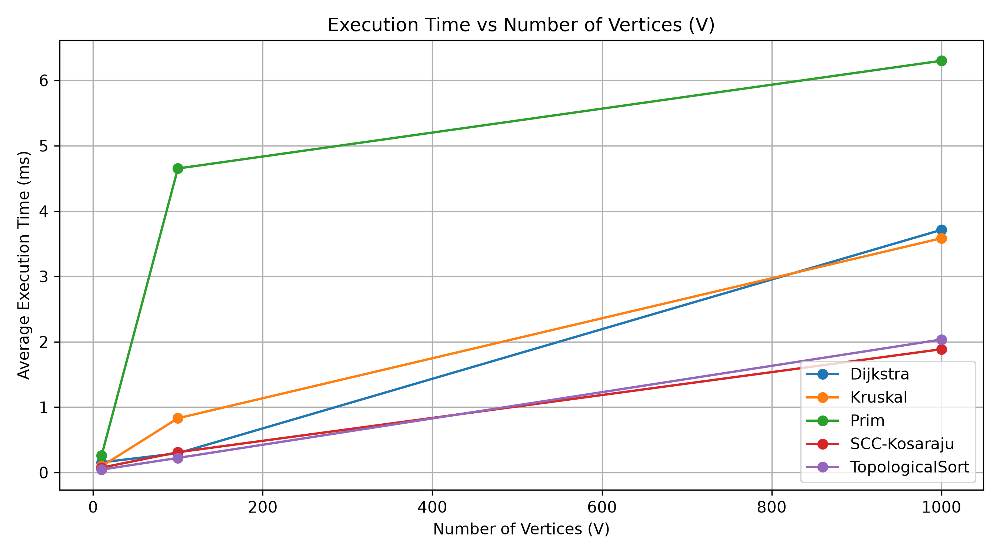

# Assignment 3 — Smart City Infrastructure and Route Planning

## 1. Overview

The goal of this project is to develop a Java application that models a smart city's infrastructure network using graph algorithms.

In this system, vertices represent city districts, edges represent roads or infrastructure connections, and edge weights represent construction costs or travel distances.

The application implements algorithms for minimum spanning trees, graph connectivity analysis, and shortest-path calculation. Experimental benchmarking is used to compare their performance on graphs of different sizes.

## 2. Implementation

The project is organized into packages according to their responsibilities.

- `graph`: Contains `Graph` and `Edge`. The graph uses an adjacency list and stores a list of edges.
- `dsu`: Contains `DSU`, which implements path compression and union by rank.
- `mst`: Contains `Kruskal`, `Prim`, and `MSTResult`.
- `connectivity`: Contains `TopologicalSort` and `SCC`.
- `shortestpath`: Contains `Dijkstra`.
- `experiments`: Contains `GraphGenerator` and `Benchmark`.

### 2.1 Kruskal's Algorithm

Kruskal's algorithm sorts all edges by weight and processes them in ascending order. An edge is added to the minimum spanning tree only if it connects two different components. The DSU structure efficiently detects whether the endpoints are already connected.

### 2.2 Prim's Algorithm

Prim's algorithm grows a spanning tree by repeatedly selecting the minimum-weight available edge using a priority queue. The implementation also handles disconnected graphs by constructing a minimum spanning forest and reporting whether the graph is connected.

### 2.3 Topological Sorting

Topological sorting is implemented using Kahn's algorithm. It calculates the in-degree of every vertex and processes vertices with zero in-degree. If not all vertices can be processed, the graph contains a cycle and no topological ordering exists.

### 2.4 Strongly Connected Components

Kosaraju's algorithm is used to find strongly connected components. It performs a DFS on the original graph, constructs the reversed graph, and performs another DFS in reverse finishing-time order.

### 2.5 Dijkstra's Algorithm

Dijkstra's algorithm calculates shortest distances from a selected source vertex. A priority queue is used to process vertices in increasing order of distance. A predecessor array allows the application to reconstruct the shortest path.

All edge weights are non-negative. Dijkstra's algorithm is not suitable for graphs with negative edge weights because its greedy correctness assumption may be violated.

## 3. Complexity Analysis

Let V denote the number of vertices and E denote the number of edges. The analysis assumes adjacency-list graph representation and a binary-heap-style priority queue where applicable.

| Algorithm | Time Complexity | Auxiliary Space |
|---|---|---|
| DSU `find` / `union` | Amortized O(α(V)) per operation | O(V) for DSU arrays |
| Kruskal | O(E log E) | O(V + E) |
| Prim | O((V + E) log E) for this implementation | O(V + E) |
| Topological Sort | O(V + E) | O(V) |
| Kosaraju SCC | O(V + E) | O(V + E) |
| Dijkstra | O((V + E) log V) under the standard binary-heap analysis | O(V + E) |

### DSU Optimization

Path compression shortens parent paths during `find` operations. Union by rank attaches a lower-rank tree to a higher-rank tree. Together, these techniques make DSU operations nearly constant-time in practice.

### Effect of Graph Size

Kruskal's performance is influenced by edge sorting. Prim and Dijkstra rely on priority queues, so processing larger graphs introduces additional queue operations. Topological sorting and Kosaraju's algorithm process vertices and edges linearly, giving O(V + E) time complexity.

## 4. Experimental Setup

Three graph configurations were used, following the assignment requirements.

| Configuration | Vertices (V) | Edges (E) |
|---|---:|---:|
| Small | 10 | 30 |
| Medium | 100 | 500 |
| Large | 1,000 | 5,000 |

A fixed random seed was used for reproducible graph generation. Undirected graphs were generated with a chain of edges first, guaranteeing connectivity, and additional unique edges were added afterward. Edge weights were generated as non-negative integers.

Directed acyclic graphs were generated by orienting edges from lower-numbered vertices to higher-numbered vertices. Separate directed graphs were generated for SCC experiments.

Each benchmark measurement used one warm-up execution followed by five timed executions. Execution time was measured using `System.nanoTime()`, and the average of the five measurements was reported.

The benchmark records execution time and operation counts. For Kruskal, Prim, and Dijkstra, the operation counters are taken from the algorithm implementations. For topological sorting and SCC, the current benchmark reports V + E as a structural operation estimate rather than counting every internal operation.

## 5. Results

The following measurements were recorded from a local Java benchmark run. Execution times are shown in milliseconds.

| Algorithm | V = 10 | V = 100 | V = 1,000 |
|---|---:|---:|---:|
| Kruskal | 0.09588 | 0.83058 | 3.58448 |
| Prim | 0.25856 | 4.65246 | 6.30040 |
| Dijkstra | 0.15580 | 0.29536 | 3.71290 |
| Topological Sort | 0.04450 | 0.22374 | 2.03516 |
| Kosaraju SCC | 0.07488 | 0.31042 | 1.88662 |

These values depend on the computer, JVM, and execution environment. They should be treated as observations from this particular run rather than universal performance guarantees.

### Plots

The benchmark plots are stored in the `results/plots/` directory.

**Execution Time vs. Number of Vertices**

## 6. Comparison and Discussion

### Kruskal vs. Prim

Both algorithms returned the same MST weight on the connected sample graph. Kruskal uses edge sorting and DSU, whereas Prim expands a tree using a priority queue.

In the benchmark, Kruskal was faster than Prim for all three tested graph sizes. This is an experimental observation and does not establish that Kruskal is always faster. Performance can depend on graph density, implementation details, and the runtime environment.

### Connectivity Algorithms

Topological sorting processed the tested DAGs successfully. A separate cyclic graph was correctly identified as unsuitable for topological ordering.

Kosaraju's algorithm identified the expected strongly connected components in the test graph. Both algorithms have linear theoretical time complexity, O(V + E).

### Dijkstra

Dijkstra returned the expected shortest distances and paths on the sample graph. Its execution time increased at the largest tested size, consistent with the additional work required to process more vertices and edges.

### Interpretation of Results

The measured times generally increased with graph size, although small benchmark differences should be interpreted cautiously. Three graph sizes are sufficient for an initial comparison but do not establish a complete performance trend. More graph sizes and repeated independent graph-generation trials would provide stronger evidence.

## 7. Testing

The implementation was tested using the following cases.

| Test Case | Expected Behavior | Observed Result |
|---|---|---|
| Single-vertex graph | MST weight is 0 | Passed |
| Disconnected undirected graph | Both MST algorithms report `connected = false` | Passed |
| Directed graph containing a cycle | Topological ordering is impossible | Passed |
| Graph with multiple SCCs | Components are identified correctly | Passed |
| Unreachable vertex | Dijkstra reports an infinite distance | Passed |
| Duplicate edge weights | Kruskal and Prim return the same MST weight | Passed |
| Connected sample graph | Kruskal and Prim return MST weight 11 | Passed |
| Shortest-path sample graph | Expected distances and paths are returned | Passed |

The test programs completed successfully with exit code 0. These checks cover the listed cases, although additional automated assertions would improve regression testing.

## 8. GitHub and Reproducibility

The project source code is organized into separate packages. The benchmark can be run from the `experiments.Benchmark` class, and the Python plotting script reads the generated CSV data and creates the required plots.

To reproduce the experiments:

1. Compile the Java source files.
2. Run `experiments.Benchmark`.
3. Save the benchmark output as `results/benchmark.csv`, excluding non-CSV diagnostic lines if any.
4. Run the Python plotting script.
5. Check the resulting CSV file and plots before updating this report.

The plotting script requires Python, pandas, and matplotlib.

## 9. Conclusion

This project implements graph algorithms for infrastructure planning, connectivity analysis, and shortest-path calculation.

Kruskal and Prim calculate minimum spanning trees, topological sorting detects whether a directed graph can be ordered without violating edge dependencies, Kosaraju identifies strongly connected components, and Dijkstra calculates shortest paths for non-negative edge weights.

The correctness tests produced the expected results, and the benchmark provided an initial comparison of algorithm performance across three graph sizes. The experimental results complement the theoretical complexity analysis, while further measurements would improve the reliability of performance conclusions.
